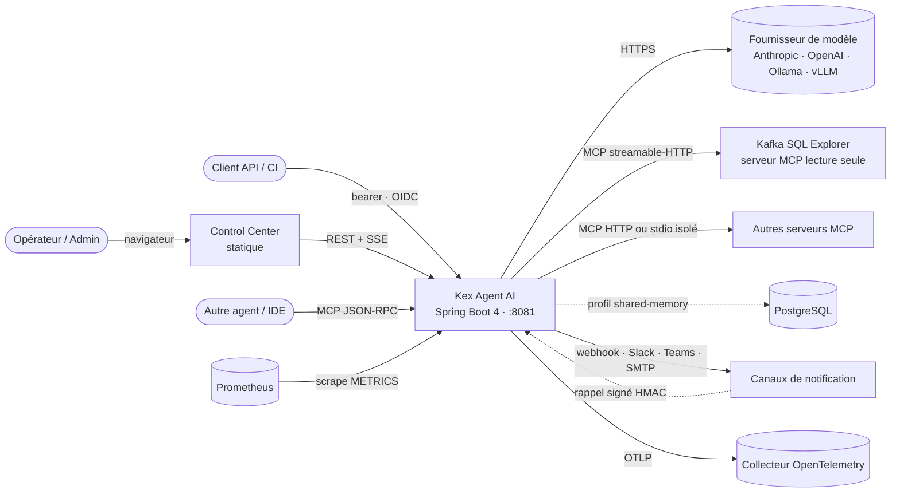
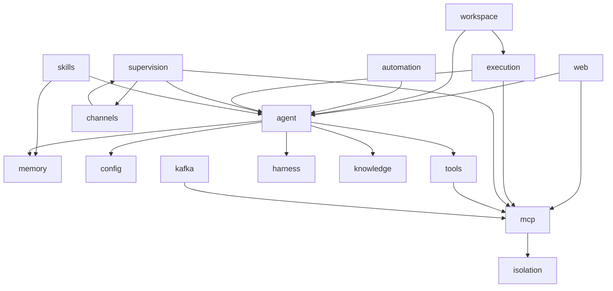
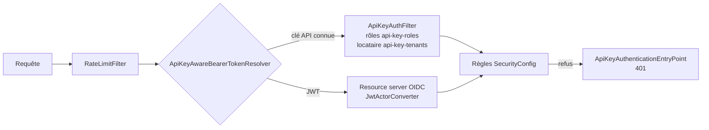
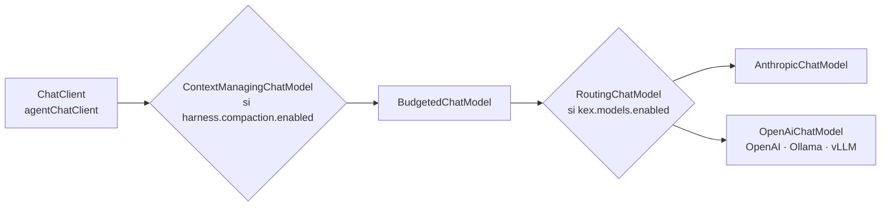
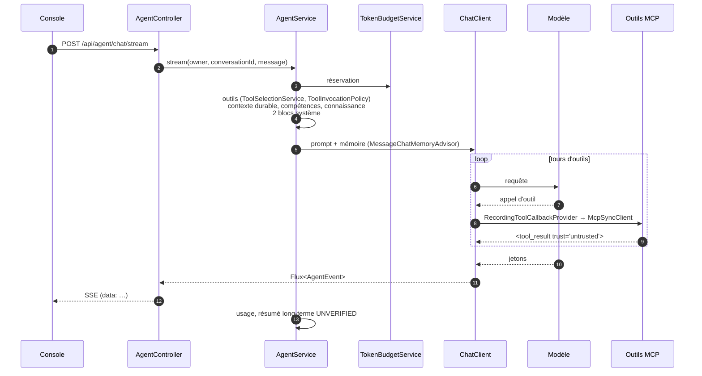
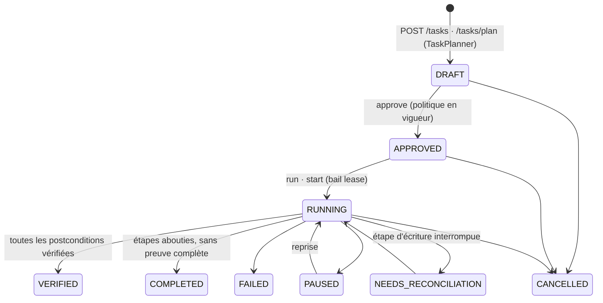
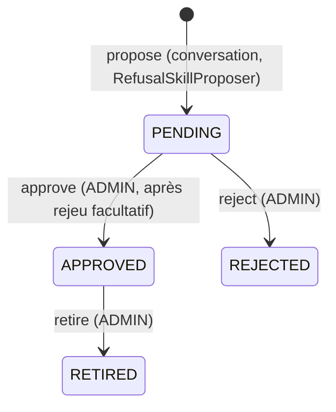
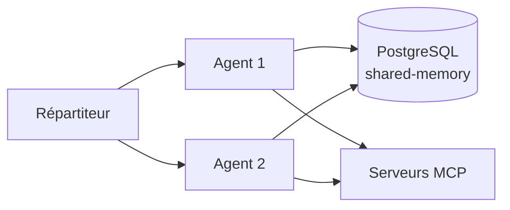

# Architecture logicielle

Document de référence : ce que le code **est** aujourd'hui, composant par composant. Les raisons
de chaque choix — et l'historique des défauts qui les ont imposés — vivent dans le journal de
décisions [`ARCHITECTURE.md`](ARCHITECTURE.md) ; les propriétés, dans
[`CONFIGURATION.md`](CONFIGURATION.md). Pour une présentation pédagogique, sans prérequis, voir le
[guide Word](guide/README.md). Chaque nom de classe, de route, de table et d'état cité
ici existe dans le code ; un nom qui disparaît du code doit disparaître d'ici.

## Sommaire

1. [Contexte](#1-contexte)
2. [Vue d'ensemble des conteneurs](#2-vue-densemble-des-conteneurs)
3. [Pile technique](#3-pile-technique)
4. [Découpage en paquets](#4-découpage-en-paquets)
5. [Surface HTTP](#5-surface-http)
6. [Sécurité](#6-sécurité)
7. [Chaîne d'appel du modèle](#7-chaîne-dappel-du-modèle)
8. [Flux d'exécution](#8-flux-dexécution)
9. [Persistance et données](#9-persistance-et-données)
10. [Configuration, profils et fonctions optionnelles](#10-configuration-profils-et-fonctions-optionnelles)
11. [Console d'exploitation](#11-console-dexploitation)
12. [Déploiement](#12-déploiement)
13. [Observabilité](#13-observabilité)
14. [Tests et chaîne de qualité](#14-tests-et-chaîne-de-qualité)
15. [Invariants transverses](#15-invariants-transverses)

---

## 1. Contexte

Kex Agent AI est un agent conversationnel et un superviseur d'exploitation. Il ne détient pas de
données métier : il **interroge** des serveurs MCP (par défaut celui de Kafka SQL Explorer, en
lecture seule), **raisonne** avec un fournisseur de modèle, et **recommande ou exécute** des
actions sous une politique d'autonomie gouvernée par des humains.



Trois rôles cohabitent dans le même processus :

| Rôle | Entrée | Composant pivot |
|---|---|---|
| Agent conversationnel | `POST /api/agent/chat*` | `AgentService` |
| Superviseur d'exploitation | cycle manuel ou planifié | `SupervisionService` |
| Serveur MCP (Kex exposé à d'autres agents) | `POST /api/agent/mcp-server` | `KexMcpServerController` |

## 2. Vue d'ensemble des conteneurs

| Conteneur | Technologie | Responsabilité | Obligatoire |
|---|---|---|---|
| Agent | JAR Spring Boot, image `eclipse-temurin:21-jre`, utilisateur `10001` | API, console, supervision, MCP client et serveur | oui |
| Fournisseur de modèle | API externe ou local (profils `ollama`, `vllm`) | génération, appels d'outils | non (sans clé : état `DEGRADED`) |
| Serveurs MCP | HTTP streamable ou processus stdio | outils, ressources, prompts | non (initialisation paresseuse) |
| PostgreSQL | sous le profil `shared-memory` | état partagé multi-instance, migrations Flyway | non |
| Volume `/var/lib/kex` | fichiers JSON / répertoires | état mono-instance hors `shared-memory` | recommandé |

Les fichiers `compose/` assemblent ces conteneurs : `smoke.yml` (agent + serveur MCP factice),
`demo.yml`, `shared-memory.yml` (PostgreSQL), `forecasts.yml` / `forecast-ci.yml` (pile de
prévision), `autoroutes.yml`, `spectrallm.yml`.

## 3. Pile technique

| Domaine | Choix |
|---|---|
| Langage / runtime | Java 21, threads virtuels (`spring.threads.virtual`) |
| Cadre | Spring Boot 4.2, Spring MVC (pas WebFlux ; Reactor sert aux flux SSE) |
| IA | Spring AI 2.1 : `spring-ai-starter-model-anthropic`, `-openai`, `-mcp-client`, `-model-chat-memory`, `-vector-store`, `-vector-store-advisor` |
| Sécurité | `spring-boot-starter-security`, `oauth2-resource-server` (JWT OIDC optionnel) |
| Résilience | Resilience4j : `circuitbreaker`, `retry`, `reactor`, `micrometer` |
| Persistance | fichiers (défaut) ou JDBC PostgreSQL + Flyway (`shared-memory`) |
| Validation | `spring-boot-starter-validation`, `json-schema-validator` (sortie structurée, arguments d'outil) |
| Documentation API | `springdoc-openapi` (`/v3/api-docs`, `/swagger-ui`) |
| Observabilité | Actuator, Micrometer Prometheus, tracing OpenTelemetry (OTLP) |
| Messagerie | `spring-boot-starter-mail` (canal e-mail, commandes Gmail) |
| Qualité | Spotless (format + en-tête SPDX), JaCoCo (85 % instructions, 70 % branches), CycloneDX (SBOM) |
| Console | HTML/CSS/modules ES natifs, aucune étape de build |

## 4. Découpage en paquets

Racine : `com.kex.agent`. Dépendances dominantes : `web` → `agent` → `config`/`tools`/`mcp`/`memory`
→ fournisseurs ; `supervision` → `agent` + `mcp` ; `execution`, `workspace`, `automation` →
`agent`/`supervision`.



### 4.1 `agent` — conversation

| Classe | Rôle |
|---|---|
| `AgentService` | Point d'entrée de toute conversation : `ask`, `askStructured`, `stream`, variantes `askReadOnly`, `askForTask`, `streamReadOnly`, `streamForTask`, rejeux `probe` / `probeTogether`, `clear`. Assemble outils, contexte durable, compétences, connaissance et les deux blocs système. |
| `AgentAnswer`, `AgentStructuredAnswer`, `AgentStream`, `AgentEvent`, `AgentUsage`, `AgentProbe` | Contrats de sortie (texte, JSON validé, flux SSE typé, consommation, rejeu). |
| `JsonSchemaOutputConverter` | Sortie structurée validée contre un JSON Schema fourni par l'appelant. |
| `TokenBudgetService`, `BudgetRepository` (`File…`/`Jdbc…`), `BudgetController` | Budget de jetons journalier, réservé avant l'appel, partagé en base sous `shared-memory`. |
| `ToolCallRecorder`, `ToolResultEvidence` | Trace des appels d'outils d'un échange, preuves citables par la supervision. |
| `SkillReaderTool` | Outil `read_skill` : lecture à la demande des compétences de domaine indexées. |
| `TaskToolPolicy` | Allowlist d'outils d'une étape de tâche durable. |
| `KafkaOperationalPlaybooks`, `AutoroutesOperationalPlaybook` | Procédures injectées selon la demande. |

### 4.2 `config` — câblage transverse

| Classe | Rôle |
|---|---|
| `AgentConfig` | `ChatClient` de l'agent (`MessageChatMemoryAdvisor`, `QuestionAnswerAdvisor` optionnel, `SimpleLoggerAdvisor` optionnel) et `ChatMemory` (`BoundedChatMemory`). |
| `BudgetConfig` | `BeanPostProcessor` qui décore tout `ChatModel` (voir §7). |
| `BudgetedChatModel`, `RoutingChatModel`, `LlmRoutingConfig` | Budget de jetons ; routage entre modèles déclarés (`kex.models`). |
| `LlmCatalogService`, `LlmViewService`, `LlmViewController`, `LlmProviderCheck` | Catalogue des modèles, vue console, avertissement de démarrage sur la configuration du fournisseur. |
| `SecurityConfig`, `ApiKeyAuthFilter`, `ApiKeyAuthenticationEntryPoint`, `ApiKeyAwareBearerTokenResolver`, `JwtActorConverter`, `ActorIdentity`, `ApiRole` | Authentification bearer / JWT, rôles, identité d'audit (§6). |
| `RateLimitFilter`, `TokenBucket`, `InMemoryRateLimiter`, `JdbcRateLimiter` | Limite de débit par clé, locale ou partagée. |
| `AgentToolRegistry`, `RecordingToolCallbackProvider` | Outils internes exposés au modèle ; enveloppe `<tool_result trust="untrusted">` de chaque résultat. |
| `McpBearerTokenCustomizer`, `ClientCredentialsTokenSource`, `McpTraceContextCustomizer` | Authentification sortante vers les serveurs MCP (statique ou OAuth2 client credentials), propagation du contexte de trace. |
| `ResilienceConfig` | Disjoncteurs `agent-model` et `mcp-tool-<connexion>` (partagé entre l'appel direct et les outils du modèle ; `mcp-tool` seul pour une connexion inconnue), retry. |
| `OpenApiConfig`, `StaticResourceConfig` (dans `web`) | Spécification OpenAPI ; service de la console. |

### 4.3 `tools` — contrôle des outils

| Classe | Rôle |
|---|---|
| `ToolSelectionService` | Sous-ensemble d'outils pertinent pour une demande (éteint par défaut, trié par nom pour préserver le cache du fournisseur). |
| `ToolInvocationPolicy` | Politiques `denied` (absolu) et `governed-only` (caché au modèle et à l'appel direct, atteignable seulement par `McpToolCatalog.callGoverned`). |
| `ToolResultPreview`, `ToolControlProperties` | Troncature des résultats, réglages. |

### 4.4 `mcp` — client, catalogue, serveur

| Sous-ensemble | Classes |
|---|---|
| Invocation | `McpToolCatalog` (`call`, `callGoverned`, ressources, diagnostics), `DynamicMcpToolCallbackProvider`, `BudgetedMcpCallback`, `ConnectionTrackingToolNames` (nom d'outil → connexion, pour le disjoncteur par serveur), `McpServerRateLimiter` |
| Inventaire dynamique | `McpServerRegistration`, `EncryptedMcpServerStore` (fichier chiffré `mcp-servers.enc`), `McpSecretRotation`, `McpConfigurationBundle`, `McpRuntimeServerView`, `McpToolDiff` |
| Santé | `McpHealthCheckScheduler`, `McpHealthSample`, `McpServerDiagnostics`, `McpConnectionTestResult` |
| Catalogue d'installation | `McpCatalogController`, `McpRecommendedCatalog`, `McpCatalogDiscoveryService`, sources `OfficialMcpRegistrySource` et `DockerMcpCatalogSource`, `McpTrustScoreCalculator` (`McpTrustScore`, `McpTrustCriterion*`) |
| Kex comme serveur MCP (`mcp/server`) | `KexMcpServerController` (JSON-RPC : `initialize`, `ping`, `tools/list`, `tools/call`, `resources/*`, `prompts/*`), `McpServerCatalog`, `McpClientSessionRegistry`, `McpServerRateLimiter`, `McpGovernedDecisionService` / `GovernedMutationRequest`, `McpServerAuditPublisher`, `KexMcpServerHealthIndicator` |

Outils exposés par Kex : `kex_status`, `kex_overview`, `kex_alerts`, `kex_incidents`,
`kex_pending_decisions`, `kex_diagnose_process`, `kex_diagnose_topic`, `kex_supervision_triage`.
Les mutations passent par une décision gouvernée, jamais par un appel direct.

### 4.5 `isolation`

`IsolatedStdioCommand`, `StdioIsolationProperties` : enveloppe de lancement d'un serveur MCP
stdio (commande, environnement, limites).

### 4.6 `memory` — mémoire et apprentissage

| Classe | Rôle |
|---|---|
| `MemoryService`, `MemoryRepository` (`InMemory…`, `File…`, `Jdbc…`), `MemoryController` | Faits mémorisés par propriétaire. |
| `LongTermMemoryService`, `LongTermMemoryController` | Résumés d'échanges `UNVERIFIED` → `VERIFIED` / `CONTRADICTED`. |
| `LearningEntry`, `LearningRepository` (`File…`, `Jdbc…`), `LearningEvidence`, `SkillScope` (`INVARIANT`, `DOMAIN`), `SkillProbe` | Entrées apprises (compétences, résumés) et leurs preuves. |
| `DurableContext`, `DurableFiles`, `MemoryTools` | Contexte durable injecté ; outils de mémoire exposés au modèle. |

### 4.7 `skills` — gouvernance des compétences

| Classe | Rôle |
|---|---|
| `SkillsService` | Cycle de vie `PENDING` → `APPROVED` / `REJECTED` → `RETIRED`, classement (`ranked`), injection, déclencheurs normalisés, refus d'un texte déjà jugé (`SkillAlreadyJudgedException`). |
| `SkillProbeService`, `ProbeSuggestion` | Rejeu contrastif d'une candidate (seule ou groupée), sans écriture en mémoire long-terme. |
| `SkillCurator`, `SkillCuration` | Ce qui est mesurable : active, dormante, doublon, non revue. Ne retire rien. |
| `RefusalSkillProposer` | Transforme N refus concordants (`RepeatedRefusals`) en proposition déterministe. |
| `CharterService`, `CharterController`, `Charter` | Charte versionnée, écrite par un `ADMIN`, hors circuit de revue. |

### 4.8 `harness` — contexte long

| Classe | Rôle |
|---|---|
| `ContextManagingChatModel`, `ContextCompactor`, `CompactingChatMemory`, `ContextSession` | Compaction de l'historique au-delà d'un seuil (`kex.agent.harness.compaction.enabled`). |
| `ToolResultRepository` (`File…`, `Jdbc…`), `StoredToolResults`, `ToolResult`, `HarnessTools` | Résultats d'outils volumineux stockés hors contexte, relus à la demande. |
| `ConversationLock` | Exclusion par conversation (table `kex_harness_lock` sous `shared-memory`). |
| `UntrustedText` | Marquage du texte d'origine externe. |

### 4.9 `knowledge`

`KnowledgeService`, `KnowledgeController`, `KnowledgeConfig` : base vectorielle optionnelle
(`kex.agent.knowledge.enabled`) branchée par `QuestionAnswerAdvisor`. Le bean `VectorStore`
n'existe que sous cette propriété.

### 4.10 `supervision` — le superviseur

| Groupe | Classes |
|---|---|
| Orchestration | `SupervisionService` (`runCycle`, `approve`, `reject`, `pause`/`resume`, maintenance, politique, vues), `SupervisionController` |
| Analyse | `CycleAnalysis` (findings sourcés, snapshots), `Observation`, `Anomaly`, `Coverage`, `StopReason`, `ProcessSnapshot`, `ProcessHistoryPoint`, `CorrelatedIncident`, `Alert` |
| Politique | `SupervisionPolicy`, `PolicyUpdate`, `Autonomy`, `ExecutionMode`, `Capability`, `Thresholds`, `ThresholdOverrides` |
| Décision | `Decision`, `DecisionStatus`, `ActionBinding`, `VerificationBinding`, `ActionVerification`, `RepeatedRefusals` |
| Planification | `SupervisionScheduler`, `CycleLock` (`LocalCycleLock`, `JdbcCycleLock`), `SupervisionScheduleConsistencyCheck` |
| État et audit | `SupervisionStateRepository` (`InMemory…`, `Jdbc…`), `AuditRepository` (`InMemory…`, `Jdbc…`), `ProcessDefinitionRepository` (`File…`, `Jdbc…`), `MaintenanceWindow` |
| Notification | `WebhookNotifier`, `NotifyProperties` |

### 4.11 `execution` — tâches durables

`TaskService`, `TaskPlanner`, `TaskGateway`, `TaskContracts`, `TaskController`,
`TaskRepository` (`File…`, `Jdbc…`), `DurableTask`, `TaskPlan`. Activé par
`kex.agent.tasks.enabled`.

### 4.12 `workspace` — espace utilisateur

`WorkspaceService`, `WorkspaceController`, `WorkspaceStore`, `WorkspaceRequest`,
`WorkspaceResultContract` : demandes d'un utilisateur `CHAT`, en flux, reprenables, liables à
une tâche durable.

### 4.13 `automation`

`AutomationService`, `AutomationController`, `ScheduledTaskExecutor`, `JdbcAutomationRepository`,
`AutomationAudit` : prompts planifiés, uniquement sous `shared-memory` et
`kex.agent.automation.enabled`.

### 4.14 `channels`

`ChannelNotifier` répartit vers `SlackChannelAdapter`, `TeamsChannelAdapter`,
`EmailChannelAdapter`. Entrées signées : `InboundApprovalController` (`InboundSignature`) et
`SlackInteractivityController` (`SlackRequestSignature`) ; commandes par e-mail :
`GmailCommandReceiver`.

### 4.15 `kafka`

Vue technique, sans recalcul : `KafkaViewService` (topics, lag via `MeasuredValue`),
`ForecastViewService`, `ForecastResourceService`, `ForecastReadinessService`,
`ForecastAssociationService` (`File…`/`Jdbc…` repository).

## 5. Surface HTTP

114 points d'entrée. Préfixe commun `/api/agent`.

| Contrôleur | Base | Routes |
|---|---|---|
| `AgentController` | `/api/agent` | `POST /chat`, `/chat/structured`, `/chat/stream` (SSE) ; `DELETE /conversations/{conversationId}` ; `/mcp/servers` (GET, POST, `test`), `/mcp/runtime-servers`, `/mcp/servers/{connection}` (PUT, DELETE, `enabled`, `secret`, `refresh`, `diagnostics`, `preview`, `resources`, `resource`), `POST /mcp/servers/{connection}/tools/{tool}`, `/mcp/configuration` (GET, POST), `/mcp/storage`, `/mcp/metrics` |
| `SupervisionController` | `/supervision` | `overview`, `status`, `processes` (+ `definitions`, POST), `alerts`, `performance`, `cycles` (GET, POST, `current`), `decisions` (+ `{decision}`, `pending`, `approve`, `reject`), `processes/{process}/maintenance` (POST, DELETE), `processes/{process}/history`, `audit`, `policy` (GET, PUT), `pause`, `resume`, `notify/test` |
| `SkillsController` | `/skills` | GET, POST, `available`, `review-queue`, `curation`, `{id}/retire`, `{id}/probe-suggestion`, `{id}/precedents`, `{id}/probe`, `probe-together`, `{id}/approve`, `{id}/reject` |
| `CharterController` | `/charter` | GET, PUT, `versions` |
| `TaskController` | `/tasks` | GET, POST, `{id}`, `bindings`, `plan`, `{id}/approve`, `{id}/run`, `{id}/cancel` |
| `WorkspaceController` | `/workspace/requests` | GET, `{id}`, `stream` (SSE), `{id}/recover/stream` (SSE), `{id}/plan` |
| `MemoryController`, `LongTermMemoryController` | `/memory`, `/memory/summaries` | lecture, suppression, `contradict` |
| `KnowledgeController` | `/knowledge` | GET, POST, DELETE |
| `McpCatalogController` | `/mcp/catalog` | GET, `{id}/install`, `discover`, `discover/{sourceId}/{candidateId}/install` |
| `KexMcpServerController` | `/mcp-server` | GET (description), POST JSON-RPC |
| `KafkaViewController` | `/kafka` | `topics`, `topics/{topic}/lag` |
| `ForecastViewController`, `ForecastResourceController`, `ForecastAssociationController` | `/forecasts` | `metrics`, `breaches`, `series/{seriesId}` (+ `resources`), `readiness`, `processes/{id}` (+ `associations` GET/PUT) |
| `AutomationController` | `/automations` | GET, POST, `audit`, `{id}` (PUT, DELETE) |
| `LlmViewController` | `/llm` | GET, `models` |
| `ChannelStatusController`, `InboundApprovalController`, `SlackInteractivityController` | `/channels` | `status`, `callback`, `slack/interactivity` |
| `BudgetController`, `WhoAmIController` | — | `GET /budgets`, `GET /whoami` (rôles, `features`) |

Hors `/api` : la console (`/`, `/app`, `/assets/**`), l'actuator (`/actuator/health`,
`/actuator/prometheus`, …) et la spécification (`/v3/api-docs`, `/swagger-ui`). Une route
conditionnée par une propriété rend `404` quand elle est éteinte ; `whoami.features` le dit à la
console avant tout appel.

## 6. Sécurité

### 6.1 Authentification



- Clés API : `kex.agent.api-key` (rôle `ADMIN`) et `kex.agent.api-keys` /
  `api-key-roles` / `api-key-tenants`. Un JWT OIDC (`kex.agent.oidc`) est accepté en parallèle.
- Le refus appartient à l'`AuthenticationEntryPoint` : dans le filtre, il bloquerait aussi les
  routes `permitAll`.
- CSRF est levé sur `/api/**` seulement.

### 6.2 Matrice d'autorisation (extrait de `SecurityConfig.securityFilterChain`)

| Ressource | `CHAT` | `OPERATOR` | `ADMIN` | `METRICS` | Anonyme |
|---|:-:|:-:|:-:|:-:|:-:|
| `GET` console, `/actuator/health`, OpenAPI | ✓ | ✓ | ✓ | ✓ | ✓ |
| `POST /channels/callback`, `/channels/slack/interactivity` (signature HMAC) | | | | | ✓ |
| `POST /chat*`, `DELETE /conversations/**`, `GET /whoami`, `/skills/available`, espace de travail (lecture, flux) | ✓ | ✓ | ✓ | | |
| `POST /workspace/requests/*/plan`, `/tasks/**`, cycle, pause/reprise, maintenance, tout autre `/api/agent/**` | | ✓ | ✓ | | |
| Appel direct d'outil MCP, inscription/édition/suppression de serveur, politique, charte, associations de prévision, file de revue, retrait de compétence, contradiction de résumé, suppression de mémoire | | | ✓ | | |
| `/actuator/prometheus` | | | ✓ | ✓ | |
| Autres endpoints actuator | | | ✓ | | |

L'ordre des `requestMatchers` est significatif : la règle générique `/api/agent/**` vient après
toutes les exceptions.

### 6.3 Autres défenses

| Menace | Défense |
|---|---|
| Injection par résultat d'outil | `RecordingToolCallbackProvider` enveloppe chaque résultat en `<tool_result trust="untrusted">` ; `UntrustedText` |
| Rejeu / falsification d'un rappel | HMAC sur corps brut + horodatage, `MessageDigest.isEqual`, correspondance expéditeur → acteur, désactivé par défaut |
| Secrets de serveurs MCP | `EncryptedMcpServerStore`, rotation `McpSecretRotation`, `PATCH …/secret` réservé `ADMIN` |
| Abus de débit | `RateLimitFilter` (local ou JDBC), `McpServerRateLimiter` côté serveur MCP |
| Arguments écrits par le modèle | une décision qui en porte n'est jamais automatique (§8.2) |
| Outils d'écriture | `ToolInvocationPolicy` : `denied`, `governed-only` |
| Image | utilisateur non root `10001`, `pebble`, `curl`, `libcurl4t64` retirés |

## 7. Chaîne d'appel du modèle

`BudgetConfig` décore chaque bean `ChatModel` à sa création :



- Un seul fournisseur actif : `spring.ai.model.chat` (deux starters sur le classpath).
- Le disjoncteur `agent-model` couvre l'appel bloquant (`Supplier` décoré) **et** le flux
  (`CircuitBreakerOperator`, posé après le plafond de durée `takeUntilOther(Mono.delay(...))`).
- `kex.agent.request-timeout` plafonne la durée totale, pas seulement le silence entre jetons.
- Le prompt système part en deux blocs (installation, puis demande) pour le cache du fournisseur.
- Exceptions fournisseur (`AnthropicException`, `OpenAIException`) → `502 BAD_GATEWAY`, jamais `401`.

## 8. Flux d'exécution

### 8.1 Une question en flux



Sur échec, l'entrée de mémoire d'une conversation à identifiant généré est purgée (à la fin de
la tâche orpheline pour un timeout).

### 8.2 Cycle de supervision

`SupervisionService.runCycle(actor)` :

1. refuse si l'agent est en pause (`AgentPausedException`) ou si `CycleLock.tryLock()` échoue
   (`CycleInProgressException`) ;
2. sans processus déclaré, termine sur un état vide honnête ;
3. vérifie le budget de jetons **avant** d'appeler le modèle ;
4. lance un échange structuré par processus (`askStructuredReadOnly`) ; ne garde de chacun que
   les lignes de son propre processus ;
5. `CycleAnalysis.findings` écarte toute anomalie sans observation citant un appel d'outil
   abouti ; un processus dont l'analyse a échoué passe en `UNKNOWN` ;
6. une fenêtre de maintenance tait alertes et décisions, jamais l'observation ;
7. `decide(anomaly)` par anomalie retenue.

```mermaid
flowchart TB
    a[Anomalie sourcée] --> cap[Capacité recommandée<br/>défaut NOTIFY]
    cap --> aut[SupervisionPolicy.effectiveAutonomy]
    aut --> args{Arguments<br/>écrits par le modèle ?}
    args -->|oui et AUTOMATIC| sup[→ SUPERVISED]
    args -->|non| f{Autonomie}
    sup --> f
    f -->|FORBIDDEN| blk[BLOCKED<br/>recommandation seule]
    f -->|AUTOMATIC et confiance ≥ plancher| ex[execute]
    f -->|AUTOMATIC sous le plancher| pend[PENDING_APPROVAL]
    f -->|SUPERVISED| pend
    pend --> notif[ChannelNotifier.approval]
    pend -->|approve, verrou par décision| ex
    pend -->|reject| rej[REJECTED → RepeatedRefusals]
    pend -->|échéance| exp[EXPIRED]
    ex --> chk{Pause, maintenance,<br/>politique changée ?}
    chk -->|oui| blk
    chk -->|non| bind{ActionBinding}
    bind -->|NOTIFY sans outil| unv[EXECUTED_UNVERIFIED / FAILED]
    bind -->|aucun outil, simulation| sim[SIMULATED]
    bind -->|aucun outil| fail[FAILED]
    bind -->|outil lié| call[McpToolCatalog.callGoverned]
    call --> ver[ActionVerification.verify]
    ver --> v1[VERIFIED]
    ver --> v2[VERIFICATION_FAILED]
    ver --> v3[VERIFICATION_UNKNOWN]
    ver --> v4[EXECUTED]
```

Capacités : `NOTIFY`, `CREATE_INCIDENT`, `RESTART_CONSUMER`, `REPLAY_MESSAGES`,
`MODIFY_CONFIGURATION`, `DECLARE_ANOMALY`, `CLEAR_ANOMALY`. Autonomie par capacité :
`AUTOMATIC`, `SUPERVISED`, `FORBIDDEN` ; le mode d'exécution (`AUTOMATIC`, `SUPERVISED`,
`MANUAL`) ne peut que la restreindre. Un plancher de confiance par capacité ne peut que relever
le plancher global.

État agrégé de l'agent (`AgentState`) : `OPERATIONAL`, `UNKNOWN`, `DEGRADED`, `ERROR`, `PAUSED`,
`ANALYSING`. État d'un processus (`ProcessState`) : `OK`, `WARNING`, `ERROR`, `UNKNOWN`.

Planification : `SupervisionScheduler` bat à intervalle fixe, décide s'il est dû, puis prend un
`CycleLock` — `JdbcCycleLock` (ligne à expiration `kex_supervision_lock`) sous `shared-memory`,
`LocalCycleLock` seulement si `schedule.single-instance` est déclaré.

### 8.3 Tâche durable



À la reprise (`claim`), une étape restée `RUNNING` redevient `PENDING` si elle était en lecture,
`UNKNOWN` (réconciliation requise) si elle pouvait écrire. Un bail (`leaseUntil`) empêche deux
instances d'exécuter la même tâche ; un sémaphore borne les tâches actives ; l'exécution part
sur un thread virtuel.

### 8.4 Compétence apprise



Un texte identique à une compétence `REJECTED` ou `RETIRED` est refusé (`409`). Les compétences
`INVARIANT` sont toujours recopiées ; les `DOMAIN` sont indexées et lues par `read_skill` quand un
outil est permis.

## 9. Persistance et données

### 9.1 Variantes de dépôt par profil

| Donnée | Hors `shared-memory` | Sous `shared-memory` (table) |
|---|---|---|
| Mémoire de conversation | `InMemoryMemoryRepository` / `FileMemoryRepository` | `JdbcMemoryRepository` (`kex_agent_memory`) |
| Apprentissage (compétences, résumés) | `FileLearningRepository` | `JdbcLearningRepository` (`kex_agent_learning`) |
| État de supervision | `InMemorySupervisionStateRepository` | `JdbcSupervisionStateRepository` (`kex_supervision_decision`, `kex_supervision_maintenance`, `kex_supervision_flag`) |
| Audit | `InMemoryAuditRepository` | `JdbcAuditRepository` (`kex_supervision_audit`) |
| Définitions de processus | `FileProcessDefinitionRepository` | `JdbcProcessDefinitionRepository` (`kex_supervision_process`) |
| Verrou de cycle | `LocalCycleLock` | `JdbcCycleLock` (`kex_supervision_lock`) |
| Limite de débit | `InMemoryRateLimiter` | `JdbcRateLimiter` (`kex_rate_limit`) |
| Budget de jetons | `FileBudgetRepository` | `JdbcBudgetRepository` (`kex_budget_counter`, `kex_budget_reservation`) |
| Tâches durables | `FileTaskRepository` | `JdbcTaskRepository` (`kex_task`) |
| Résultats d'outils (harness) | `FileToolResultRepository` | `JdbcToolResultRepository` (`kex_tool_result`, `kex_harness_lock`) |
| Associations de prévision | `FileForecastAssociationRepository` | `JdbcForecastAssociationRepository` (`kex_forecast_association`) |
| Espace de travail | fichier | JDBC (`kex_workspace_request`) |
| Automatisations | — | `JdbcAutomationRepository` (`kex_automation`, `kex_automation_audit`) |
| Serveurs MCP dynamiques | `EncryptedMcpServerStore` (fichier chiffré) | idem |
| Historique de chat Spring AI | `BoundedChatMemory` | dépôt JDBC Spring AI |

### 9.2 Migrations Flyway

| Version | Objet |
|---|---|
| `V1__baseline` | Tables historiques, en `IF NOT EXISTS` (rétro-installation sur base existante, `baseline-version: "0"`) |
| `V2__supervision_process` | Définitions de processus |
| `V3__forecast_association` | Associations processus ↔ séries |
| `V4__durable_tasks` | Tâches durables |
| `V5__verified_learning` | Statut et preuves de l'apprentissage |
| `V6__shared_budgets` | Compteurs et réservations de budget |
| `V7__workspace_requests` | Espace de travail |
| `V8__skill_scope_and_probes` | Portée des compétences, rejeux |
| `V9__skill_reads` | Lectures de compétences |
| `V10__harness_context` | Résultats d'outils, verrou de conversation |

Flyway n'est actif que sous `shared-memory` ; hors de ce profil, `DataSourceAutoConfiguration`
et `FlywayAutoConfiguration` sont exclus. Les tests de dépôt JDBC rejouent la vraie migration
(`FlywayTestSchema.migrate`).

## 10. Configuration, profils et fonctions optionnelles

### 10.1 Profils

| Profil | Effet |
|---|---|
| (aucun) | État en fichiers sous `/var/lib/kex` ou en mémoire ; mono-instance |
| `shared-memory` | PostgreSQL + Flyway pour tout l'état ; prérequis du multi-instance, de la planification partagée et des automatisations |
| `ollama`, `vllm` | Fournisseur local via l'API compatible OpenAI |

### 10.2 Fonctions activables

| Propriété | Défaut | Active |
|---|---|---|
| `kex.agent.supervision.enabled` | `true` | Superviseur et ses routes |
| `kex.agent.supervision.schedule.enabled` | `false` | Cycle planifié (avec `shared-memory` ou `single-instance`) |
| `kex.agent.tasks.enabled` | `false` | Tâches durables |
| `kex.agent.knowledge.enabled` | `false` | Base vectorielle et `QuestionAnswerAdvisor` |
| `kex.agent.memory.enabled` | `true` | Mémoire de faits |
| `kex.agent.automation.enabled` | `false` | Prompts planifiés (`shared-memory` requis) |
| `kex.agent.channels.enabled` / `.inbound.enabled` | `false` | Notifications ; rappels entrants signés |
| `kex.agent.gmail.enabled` | `false` | Commandes par e-mail |
| `kex.agent.rate-limit.enabled` | `true` | Limite de débit |
| `kex.agent.harness.compaction.enabled` | `false` | Compaction du contexte |
| `kex.mcp.server.enabled` | `false` | Kex exposé comme serveur MCP |
| `kex.mcp.health-check.enabled` | `true` | Sondes périodiques des serveurs MCP |
| `kex.models.enabled` | `false` | Routage multi-modèle |

Contrôles de cohérence au démarrage (avertissements, pas échecs) : `LlmProviderCheck`,
`SupervisionScheduleConsistencyCheck`, `AutomationTimeoutConsistencyCheck`,
`McpBearerTokenCustomizer` (jeton sans préfixe).

Le client MCP reste en initialisation paresseuse (`spring.ai.mcp.client.initialized: false`) :
un serveur injoignable ne doit pas empêcher le démarrage. Les serveurs s'adressent par **clé de
connexion**.

## 11. Console d'exploitation

Servie depuis `src/main/resources/static/` (`index.html`, `app/index.html`, `assets/`), sans
build. Modules ES natifs :

| Module | Rôle |
|---|---|
| `core.js` | Registre des panneaux (clé d'URL), routage par `hash`, `busy(...)`, `featureApi`, `confirmAction`, identifiants (`sessionStorage`) |
| `console.js`, `console.css` | Coquille (`.shell` en `height: 100dvh`), navigation |
| `supervision.js`, `overview-summary.js`, `process-creation.js`, `process-forecasts.js` | Supervision, vue d'ensemble, processus |
| `chat.js`, `user-stream.js` | Conversation ; découpeur SSE unique `events()` |
| `tools.js`, `mcp-services.js`, `mcp-ux.js`, `mcp-ux-guard.js`, `mcp-server.js` | Serveurs MCP, invocation, Kex serveur |
| `skills.js`, `blind-review.js`, `memory.js`, `summaries.js`, `knowledge.js` | Gouvernance de l'apprentissage |
| `tasks.js`, `automations.js`, `channels.js`, `kafka.js`, `forecasts.js`, `llm.js` | Fonctions dédiées |
| `user-*.js`, `user-workspace.css` | Espace de travail utilisateur (`CHAT`) |

`mcp-services.js` et les autres modules de fonctions pures n'importent aucun module d'interface :
ils sont testés sous Node (`src/test/frontend`).

Le rendu repose sur un système de surfaces défini par des jetons en tête de `console.css`. Il
compte quatre matériaux : la base, presque opaque et réservée à la lecture, puis trois verres
(fin, moyen, épais). S'y ajoutent quatre niveaux de profondeur, des rayons, des courbes de
mouvement et six rôles typographiques. Le flou est réservé aux plans parents : rail, barre du
haut, menus, dialogues et tiroirs. Les matériaux redeviennent opaques sans `backdrop-filter` ou en
contraste renforcé. `user-workspace.css` recopie les mêmes valeurs pour l'espace utilisateur.
Sur grand écran (1360 px et plus), la vue d'ensemble devient une grille de douze colonnes dont
chaque bloc occupe une largeur selon son poids, sans changer l'ordre choisi dans
« Personnaliser », où chaque bloc qui partage une rangée peut aussi passer en pleine largeur.

## 12. Déploiement

Image en deux étapes (`Dockerfile`) : construction `eclipse-temurin:21-jdk` avec cache Maven,
exécution `eclipse-temurin:21-jre`, `-XX:MaxRAMPercentage=75.0`, port `8081`, volume
`/var/lib/kex`, utilisateur `10001`. Les chemins de stockage sont fixés par variables
d'environnement (`KEX_AGENT_MEMORY_STORAGE_DIRECTORY`, `KEX_MCP_RUNTIME_STORAGE_PATH`,
`KEX_AGENT_TASKS_STORE_PATH`, …).



Multi-instance : exige `shared-memory` (verrous de cycle, budget, débit, tâches, conversation en
base). Hors de ce profil, une seule réplique.

Publication (`publish.yml`) : sur tag, version du pom réalignée sur le tag, image construite une
première fois en local pour le scan Trivy, puis poussée depuis le même cache.

## 13. Observabilité

| Signal | Source |
|---|---|
| Santé | `/actuator/health` (public), `KexMcpServerHealthIndicator` |
| Métriques | `/actuator/prometheus` (`METRICS` ou `ADMIN`) ; `kex.mcp.tool.call`, `kex.mcp.server.request`, `kex.mcp.server.up` ; `gen_ai.client.token.usage` (filtrer `gen_ai.token.type`) ; disjoncteurs Resilience4j |
| Traces | Micrometer Tracing → OpenTelemetry OTLP ; contexte propagé aux serveurs MCP (`McpTraceContextCustomizer`) |
| Audit métier | `AuditRepository` (`/supervision/audit`), `McpServerAuditPublisher`, `AutomationAudit` |
| Journal des prompts | `kex.agent.log-interactions` (`SimpleLoggerAdvisor` en `DEBUG`) |

Détail : [`OBSERVABILITE.md`](OBSERVABILITE.md).

## 14. Tests et chaîne de qualité

| Niveau | Contenu |
|---|---|
| Unitaires et intégration Java | 165 classes `*Test` (JUnit, Mockito, MockMvc, H2 + vraie migration Flyway, `reactor-test`) |
| Fonctions pures de la console | `src/test/frontend/*.mjs` sous Node |
| Navigateur | `src/test/browser/*.mjs` sous Playwright, contre un agent réel ; `KEX_CPU_THROTTLE` ralentit le processeur |
| Surfaces | `src/test/frontend/contrast.mjs` (contraste AA des jetons, clair et sombre) ; `src/test/browser/surfaces.mjs` (verre, opacité des menus, téléphone, mouvement réduit, contraste renforcé, grille), captures en artefact CI `console-surfaces` |
| Documentation | `scripts/check-architecture-doc.py` (chaque nom cité ici existe dans le code) ; `scripts/check-guide-values.py` (les valeurs du guide pédagogique sont celles de `application.yml`) |
| Évaluations d'agent | `agent-evals.yml`, corpus avec garde anti-fuite ([`AGENT-EVALUATIONS.md`](AGENT-EVALUATIONS.md)) |

Workflows CI : `ci.yml` (jobs `build`, `mcp-interop`, `browser`, `docker`, `explorer-contract`,
`refresh-screenshots`), `browser-throttled.yml` (hebdomadaire), `mcp-browser.yml`,
`forecast-stack.yml`, `codeql.yml`, `scorecard.yml`, `ecosystem.yml`, `repository-links.yml`,
`publish.yml`, `pages.yml`, `dockerhub-description.yml`.

`./mvnw verify` enchaîne format et en-têtes SPDX (Spotless), tests, couverture (JaCoCo, échec
sous 85 % / 70 %) et SBOM (CycloneDX).

## 15. Invariants transverses

Les règles que tout composant respecte ; leur justification est dans
[`ARCHITECTURE.md`](ARCHITECTURE.md) et [`CLAUDE.md`](../CLAUDE.md).

1. **Absence ≠ zéro ≠ OK.** Une mesure absente reste absente, un état illisible vaut `UNKNOWN`,
   un taux sur zéro verdict vaut `null`.
2. **Une affirmation cite sa source.** Une anomalie sans appel d'outil abouti est écartée.
3. **Le modèle ne déclenche jamais seul ce qu'il a écrit.** Arguments proposés → validation
   humaine ; les outils `governed-only` ne sont atteints que par une décision approuvée.
4. **La politique ne peut que restreindre.** Mode d'exécution et planchers par capacité ne
   relâchent jamais la politique globale.
5. **Tout ce qui part seul passe par un verrou.** Cycle (`CycleLock`), décision (verrou par
   identifiant), tâche (bail), conversation (`ConversationLock`).
6. **Le budget se vérifie avant la dépense.** Cycle et conversation réservent des jetons avant
   l'appel au modèle.
7. **Une fonction éteinte n'est pas une panne.** `404` attendu, annoncé par `whoami.features`.
8. **Le résultat d'un outil est une donnée non fiable**, jamais une instruction.
